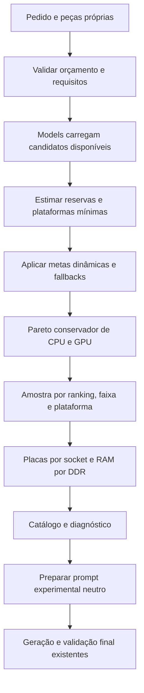

# Seleção inteligente — Etapa 3 e manutenção

Este documento descreve a implementação experimental, suas políticas e seus limites.
O fluxo antigo `CriarBuildService.executar` continua sendo a implementação do endpoint
existente. O seletor não foi colocado automaticamente na rota e não chama IA nem salva
builds por conta própria. A comparação entre estratégias continua possível.

## 1. Visão do fluxo



Há três decisões diferentes:

1. **Elegibilidade:** existe preço válido, disponibilidade e benchmark comparável?
2. **Seleção:** quais alternativas representam melhor o catálogo dentro do orçamento?
3. **Validação final:** a combinação escolhida funciona, contém o necessário e respeita
   o orçamento e a capacidade solicitada? Essa etapa continua obrigatória.

Não somamos todos os candidatos como uma build. Eles são alternativas.

## 2. Responsabilidades dos arquivos

| Arquivo | Responsabilidade |
| --- | --- |
| `models/peca.py` | `listar_candidatos_disponiveis`: consulta completa, sem amostrar antes de planejar |
| `models/benchmark.py` | `_consulta_benchmark`: filtro SQL compartilhado; `listar_pool_benchmark` carrega o pool antes do corte |
| `planejar_orcamento_componentes_service.py` | Política de perfis, reservas mínimas, metas por categoria e estimativas de plataforma |
| `planejar_armazenamento_service.py` | Menor custo de capacidade com até um modelo SSD e um HD, incluindo quantidades |
| `amostra_inteligente_service.py` | Pareto, faixas, mistura dos rankings e preservação de plataformas |
| `seletor_inteligente_service.py` | Orquestra validação, carregamento, planejamento, seleção, cotas e retorno |
| `criar_build_service.py` | Reutiliza conversão de fichas/prompt e a geração/validação existentes |

Nenhum dos novos services executa SQL diretamente. Os algoritmos de planejamento e
amostragem recebem dicionários, não dependem de Flask/SQLAlchemy e podem ser testados isoladamente.

## 3. Entrada e uso

Dentro de um contexto Flask com o banco preparado e os benchmarks importados:

```python
from services.build_service.seletor_inteligente_service import SeletorInteligenteService

pedido = {
    "nome": "PC para jogos",
    "descricao": "Montagem para jogos",
    "utilidade": "Jogos",
    "orcamento": 8000,
    "prioridade_montagem": "desempenho",  # ou custo_beneficio
    "armazenamento_minimo_gb": 500,
    "percentual_perifericos": 0,
    "pecas_proprias": {},
    "aparencia": {"cor": "preto"},
    "limites_candidatos": {"processador": 12, "placa_video": 12, "placa_mae": 24, "memoria_ram": 24},
}

seletor = SeletorInteligenteService()
resultado = seletor.executar(pedido)       # Candidatos e diagnóstico; sem IA/salvamento.
preparado = seletor.preparar_geracao(pedido)  # Alternativa: já cria catálogo numérico e prompt.
```

Escolha uma das duas chamadas; usar ambas repete a seleção. `preparar_geracao` exige os
textos do pedido, verifica categorias obrigatórias e planejamento de periféricos, e retorna
`catalogo`, `prompt`, `proprias` e `detalhes_proprias`, além dos candidatos e diagnósticos.

Para um teste de geração sem salvamento, reutilize `_gerar_validada` com o prompt/catálogo
preparados, o mesmo pedido, seus tetos e `armazenamento_minimo_gb`. `_gerar_validada` é um
método interno que pode verificar espaço da conta numa correção; use o mesmo ambiente e
procedimento isolado dos testes. Não é uma API pública nova nem um bypass de autenticação.

O endpoint antigo não recebe um catálogo arbitrário do cliente. O planejamento experimental
é calculado no servidor e passado ao prompt pelo adaptador, não aceito como verdade de um campo do usuário.

## 4. Orçamento dinâmico

A validação de valor/centavos, divisão PC/periféricos e mínimos continua a mesma. O teto
absoluto de busca também preserva a margem anterior:

```text
margem = min(total / 2, max(800, total * 0.25))
teto_de_busca = min(total - margem, teto_do_PC)
```

Sobre esse teto, o planejador cria **metas de busca por categoria**, não parcelas que
precisam ser gastas. Somar todos esses tetos não representa o preço de uma build.

A política inicial `PERFIS` distingue jogos, trabalho pesado, uso leve e equilibrado.
Reconhece jogos pelo helper existente; sem uso informado não cria os tetos de perfil.
Até R$ 4.000 e acima de R$ 10.000 de teto do PC, os pesos de CPU/GPU/plataforma mudam.
Custo-benefício reduz as metas de CPU/GPU; reaproveitar CPU em jogos amplia a meta da GPU.
São **heurísticas configuráveis de produto**, não recomendações derivadas de testes científicos.

Exemplo da política para R$ 8.000 no PC, jogos e desempenho:

| Busca | Meta inicial |
| --- | ---: |
| CPU | R$ 1.760 |
| GPU | R$ 4.000 |
| Placa-mãe | R$ 1.120 |
| RAM | R$ 1.280 |
| Plataforma mínima estimada | R$ 3.840 |

Também há metas para armazenamento, fonte, gabinete, refrigeração e acessórios.
Periféricos usam sua própria reserva; não recebem o teto do PC e sua sobra não é transferida.
Os valores calculados ficam em `planejamento_orcamento.tetos_sugeridos`.

### Reservas a partir dos preços reais cadastrados

O planejador reserva o menor custo disponível de fonte/gabinete/armazenamento e acessório
de rede necessário, sem cobrar novamente peças próprias. Para armazenamento solicitado,
considera capacidade e quantidade (até 64 de cada tipo), inclusive combinações SSD + HD,
sem assumir que um único disco precisa atingir o mínimo. O cálculo corresponde ao contrato
atual de um modelo por categoria e não certifica portas/baias/interfaces. Não inventa preços ou usa zero silenciosamente quando falta uma categoria:
a estimativa fica parcial e a pendência aparece em `avisos`.

Para cada CPU, procura o menor custo de placa-mãe do mesmo socket e RAM do DDR da placa.
Acrescenta refrigeração quando necessária e disponível, respeitando as exclusões por peça própria.
A escolha da placa-mãe própria restringe a estimativa e os candidatos de CPU ao socket conhecido.
RAM própria reconhecida também restringe o DDR das placas sugeridas.

Em jogos, verifica se ainda sobra espaço para pelo menos a GPU candidata mais barata.
A verba restante das plataformas selecionadas também limita as GPUs candidatas.

Isso é um **limite inferior de preço**, não uma solução completa de compatibilidade:
BIOS, potência, conectores, slots e encaixe ainda exigem a validação final. Uma ficha ausente
não prova inviabilidade; quando necessário, a alternativa é preservada como pendente.

## 5. Fallbacks e requisitos

- Se a meta de CPU ou de um grupo de placas/RAM não comportar nenhuma opção disponível,
  preserva as mais baratas dentro do teto absoluto e registra `flexibilizacoes`.
- Uma alternativa da cor pedida pode ser preservada fora da meta quando nenhuma dentro
  dela atender à cor, sempre dentro do teto absoluto e com registro da flexibilização.
- Se as plataformas viáveis excederem somente a meta orientativa de plataforma, essa meta
  pode ser flexibilizada. Orçamento real, reserva de periféricos e disponibilidade não são relaxados.
- Se o cálculo conhecido não comportar nenhuma plataforma, não inventa uma combinação.
  Categorias faltantes são informadas e a preparação completa pode recusar a geração.
- Se não houver nenhuma peça com benchmark comparável, pode retornar peças sem pontuação
  ordenadas por preço/diversidade técnica, identificadas com `sem_benchmark` e aviso explícito.
  Não mistura esse fallback com o ranking medido, não converte ausência em pontuação zero
  e não aceita pontuações inválidas ou de outro teste como substitutas.
- Preserva uma referência de armazenamento capaz de atender o mínimo informado, eventualmente
  com múltiplas unidades. A capacidade final e o espaço físico são validados após a IA.
- Com menos candidatos legítimos que o limite, retorna menos. Não reintroduz dominados só para encher a lista.
- Cada grupo de socket/DDR recebe sua parte das vagas; os outros grupos usam as sobras.

`armazenamento_minimo_gb` é opcional: não há um mínimo oculto de 500 GB. Quando o cliente
não o envia, a implementação não pode rejeitar um SSD só por ter 120 GB.

## 6. Pareto: o que é removido e o que não é

A peça A domina B apenas se os recursos comparados forem equivalentes e A:

- Custar no máximo o preço de B.
- Não consumir mais energia.
- Não perder em nenhuma métrica de benchmark usada.
- Melhorar estritamente em pelo menos uma dessas dimensões.

CPU compara CPU Mark **e** Single Thread. GPU compara G3D **e** G2D. CPU e GPU nunca
são comparadas entre si, e testes/versões diferentes não são misturados.

A chave técnica conserva socket, núcleos/threads, vídeo integrado e cooler de CPU;
GPU conserva chip e memória. Outros recursos disponíveis e dimensões também distinguem
variantes. Quando há preferência de cor, cores diferentes são preservadas. Campo essencial
desconhecido, métrica ausente ou consumo desconhecido impedem concluir dominância.
Não há eliminação por fabricante nem por semelhança de nome.

Exemplo: com recursos iguais, A custa 100, marca 200/100 e consome 65; B custa 150,
marca 150/90 e consome 65. B é dominada. Se B tiver vídeo integrado que A não tem, ou
consumir só 35, não é descartada por essa regra. Empate completo também não elimina uma peça.

**Ao adicionar um recurso importante ao catálogo, revise `RECURSOS` e `EXTRAS`.** Se faltar
informação necessária para dizer que as peças são equivalentes, mantenha-as. Pareto não
é prova de superioridade em todos os jogos nem de equivalência em funcionalidades não cadastradas.

## 7. Formação da amostra

Depois de orçamento e Pareto:

1. Preserva o melhor candidato do ranking principal.
2. Em CPUs, reserva representantes de socket e presença/ausência de vídeo integrado.
3. Preserva candidatos nas faixas de preço: até 40%, de 40% a 70% e acima de 70% do teto
   relevante. Esses rótulos são de **preço**, não uma promessa de desempenho.
4. Inclui uma alternativa da cor pedida quando disponível e ainda há vaga.
5. Intercala desempenho e pontos/preço até atingir o limite.
6. Ordena a lista final pela preferência principal, com desempate determinístico.

O tamanho limitado pode impedir representar todos os grupos. O diagnóstico informa as
plataformas elegíveis e representadas. Um socket não ganha prioridade por ser AMD ou Intel.

Placas-mãe continuam distribuídas pelos sockets selecionados, e RAM pelos DDRs das placas.
Essas cotas usam as metas de preço por grupo, com fallback barato para não apagar um grupo
inteiro. Preferência de cor é considerada dentro dos grupos. As demais categorias reutilizam
a amostragem existente e o limite é aplicado estritamente, inclusive quando vale 1.

Por padrão: 12 CPUs, 12 GPUs, 24 placas-mãe, 24 RAMs e 12 por outra categoria. `limite`
continua configurando CPU/GPU; `limites_candidatos` permite sobrescrever uma categoria
com inteiro de 1 a 200. Gabinete de referência e armazenamento necessário substituem uma
vaga quando a lista já está cheia, em vez de ultrapassar o limite.

## 8. Leitura do retorno e diagnóstico

| Campo | Como usar |
| --- | --- |
| `componentes_selecionados` | Lista com IDs `categoria:id`, mantendo o contrato anterior |
| `planejamento_orcamento` | Perfil, reservas, metas, estimativas por CPU, avisos e flexibilizações |
| `amostragem` | IDs dominados removidos, distribuição por faixa e plataformas representadas |
| `categorias_pendentes` | Categorias básicas que não foram encontradas/selecionadas, descontando peças próprias |
| `catalogo` / `prompt` | Disponíveis em `preparar_geracao`, prontos para o gerador existente |

O catálogo experimental também leva os pontos e identificadores dos testes de CPU/GPU;
esses campos não são removidos na conversão de fichas. Não representam FPS nem pontuação
do conjunto. IDs numéricos agrupados são usados apenas no catálogo de geração. Não misture esse
formato com a lista pública `categoria:id`.

O prompt experimental usa `preferencia_neutra=True`: não orienta a IA a preferir Ryzen.
O prompt padrão do fluxo antigo conserva seu comportamento para permitir comparação
controlada. Para experimentar o novo, use o adaptador, não reconstrua o prompt ignorando o planejamento.

## 9. Como fazer manutenção

| Mudança desejada | Onde começar |
| --- | --- |
| Alterar distribuição por uso | `PlanejarOrcamentoComponentesService.PERFIS` |
| Ajustar faixas de orçamento | `PlanejarOrcamentoComponentesService.executar` |
| Nova reserva ou requisito mínimo | `_reserva_basica`, `_plataforma_minima` e validação final correspondente |
| Evitar descarte por recurso novo | `AmostraInteligenteService.RECURSOS` / `EXTRAS` |
| Alterar faixas de preço ou mistura | `faixa` / `executar` em `AmostraInteligenteService` |
| Alterar cotas e limites | `_preparar_contexto`, `_amostrar_grupos`, `_distribuir_vagas` |
| Investigar ausência de candidato | Conferir pool, estimativa, teto/fallback, dominados e amostra, nessa ordem |
| Mudar consulta ou filtro SQL | Models; não inserir `.query` nos services |

Os testes puros usam dicionários para verificar as regras sem banco. Os de integração
usam SQLite temporário e verificam seleção, requisitos, peças próprias, limites, cotas,
fallbacks e preparação sem salvar. Não há download, scraper ou importação de produção nesta etapa.

```bash
cd backend
../venv/bin/python -m pytest tests/services/build_service/test_amostra_inteligente.py \
  tests/services/build_service/test_planejar_orcamento_componentes.py \
  tests/services/build_service/test_planejar_armazenamento.py \
  tests/services/build_service/test_seletor_inteligente.py -q
../venv/bin/python -m pytest -q
```

Para medir se a política melhorou, compare várias gerações com o mesmo catálogo/modelo,
guardando respostas e diagnósticos por tentativa: taxa de builds válidas, presença de
categorias, requisitos atendidos, distribuição de custo, tamanho do prompt e tempo.
Uma única resposta da IA não demonstra superioridade do seletor nem desempenho em jogos.

### Custo computacional e crescimento do catálogo

O pool atual é carregado integralmente depois dos filtros de preço/disponibilidade/teste.
Pareto custa até O(n²) por grupo técnico; a estimativa de plataforma cruza CPUs, placas
e RAM disponíveis. O planejador de armazenamento reduz primeiro sua fronteira de
preço/capacidade para então avaliar quantidades de SSD e HD, até 64 por tipo.
O custo é adequado ao catálogo local usado no teste (centenas de peças por categoria),
mas deve ser medido antes de expandir muito o banco. Se precisar paginar, não aplique
um top-N global antes de preservar plataformas/faixas: isso recriaria o problema original.

Verificação local desta etapa, sem chamada à IA: com R$ 8.000 para jogos, armazenamento
mínimo de 500 GB e as duas prioridades, o catálogo de teste preservou AM4, AM5 e LGA1700,
faixas de preço distintas e os limites por categoria. Isso testa a seleção/preparação;
não é uma nova medição de FPS nem uma garantia de qualidade da resposta futura da IA.
